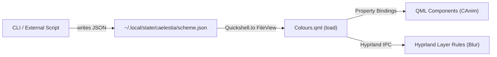

# Comprehensive Architecture Analysis: Caelestia Quickshell Shell

> **Study Scope**: This document analyzes the internal architecture, animation mechanisms, drawer/panel lifecycle, theming pipeline, system service bindings, C++ plugins, Hyprland integrations, and performance optimizations of `caelestia-shell` and `caelestia-dots`.  
> **Repository Context**: Read-only investigation of `caelestia-dots/shell` and `caelestia-dots/caelestia`.

---

## 1. Project Map & Folder Responsibilities

### 1.1 Entry Point: `shell.qml`

The execution flow begins at `shell.qml` in the repository root. It defines early engine-level pragmas, initializes global environment variables, eagerly bootstraps core singletons, and mounts top-level modules and background daemons.

```qml
// File: shell.qml (Lines 1-5)
//@ pragma Env QS_CRASHREPORT_URL=https://github.com/caelestia-dots/shell/issues/new?template=crash.yml
//@ pragma DefaultEnv QS_NO_RELOAD_POPUP=1
//@ pragma DefaultEnv QS_DROP_EXPENSIVE_FONTS=1
//@ pragma DefaultEnv QSG_RENDER_LOOP=threaded
//@ pragma DefaultEnv QT_QUICK_FLICKABLE_WHEEL_DECELERATION=10000
```

These environment pragmas configure low-level Qt Quick engine behavior:
- `QSG_RENDER_LOOP=threaded`: Forces Qt Quick's threaded scene graph renderer, offloading GPU rendering passes to a dedicated render thread for stutter-free 120/144Hz animation pacing independent of main-thread JavaScript execution.
- `QS_DROP_EXPENSIVE_FONTS=1`: Instructs Quickshell font resolution to avoid costly fallback scans that hitch frame times.
- `QT_QUICK_FLICKABLE_WHEEL_DECELERATION=10000`: Sets sharp kinetic friction on scrollable flickables.

The root object is a `ShellRoot`, which completes setup:

```qml
// File: shell.qml (Lines 17-31)
ShellRoot {
    id: root
    settings.watchFiles: true

    Component.onCompleted: {
        // Force certain singletons to load on shell init instead of lazily
        Notifs;
        Players;
        Brightness;
        Weather.reload();

        if (GlobalConfig.utilities.vpn.enabled)
            VPN;
    }
```

Key startup behaviors:
1. **File Watching**: `settings.watchFiles: true` enables dynamic live hot-reloading across the QML tree during shell development.
2. **Eager Singleton Hydration**: Quickshell loads QML singletons lazily upon first property access. Accessing bare identifiers (`Notifs; Players; Brightness;`) forces immediate D-Bus registration and initial state polling during startup, preventing frame drops during the first user interaction.
3. **Global Root Binding**: `Binding { target: ShellState; property: "shellRoot"; value: root }` exposes the root node to the singleton service layer.
4. **Module & Daemon Mounting**: Instantiates `Background`, `Drawers`, `AreaPicker`, and `Lock`, alongside headless daemons (`Shortcuts`, `BatteryMonitor`, `GameMode`, `IdleInhibit`, and `IdleMonitors`).

### 1.2 Folder Layout and Module Responsibilities

The project layout divides concerns across well-defined subsystems:

| Directory | Core Responsibility |
| :--- | :--- |
| `assets/` | Static runtime assets: Google Sans Flex variable font (`GoogleSansFlex-VariableFont_GRAD,ROND,opsz,slnt,wdth,wght.ttf`), fallback wallpapers, PAM auth configs (`pam.d/howdy`, `fprint`, `passwd`), and terminal wrapper scripts (`wrap_term_launch.sh`). |
| `components/` | Reusable design system controls and animation primitives (`Anim.qml`, `CAnim.qml`, `AnchorAnim.qml`, `AnimLoader.qml`, `ButtonBase.qml`, `FilledSlider.qml`, `StyledWindow.qml`, `StateLayer.qml`, `Mask.qml`, `Elevation.qml`). |
| `daemons/` | Headless, event-driven background services (`BatteryMonitor.qml`, `GameMode.qml`, `IdleInhibit.qml`, `IdleMonitors.qml`, `Shortcuts.qml`). |
| `extras/` | Standalone C++ helper targets, such as `version.cpp` for git tag and commit embedding. |
| `modules/` | User-facing visual desktop components: `bar/`, `drawers/` (sliding panel coordinator), `launcher/`, `lock/`, `nexus/` (control center & settings), `notifications/`, `osd/`, `session/`, `sidebar/`, `utilities/`, `background/`, `areapicker/`, and `windowinfo/`. |
| `plugin/` | Native C++ QML plugin (`caelestia-plugin` / `Caelestia` namespace): implements native config parsing, SDF blob mesh generation, hardware sensor readers, image luminance analysis, and compiled GLSL transition shaders. |
| `scripts/` | Tooling and quality assurance scripts: Python and fish scripts for linting (`qml-lint-conventions.py`) and translation string checks (`trs-check.py`). |
| `services/` | Headless system state singletons: `Audio.qml`, `Brightness.qml`, `Colours.qml`, `Hypr.qml`, `Nmcli.qml`, `Notifs.qml`, `Players.qml`, `Recorder.qml`, `Screens.qml`, `ShellState.qml`, `Wallpapers.qml`, and `Weather.qml`. |
| `utils/` | Shared utility singletons and algorithms: `Icons.qml`, `Images.qml`, `Paths.qml`, `Searcher.qml` (fuzzy search integration with `fzf.js` and `fuzzysort.js`), and `SysInfo.qml`. |
| `nix/` | Declarative package management: Nix flake definitions and Home Manager integration modules. |

---

## 2. Animations Architecture

### 2.1 Where Durations, Curves, and Spring Settings Are Defined

Animation settings are governed by a **central C++ configuration subsystem** exposed to QML through the `Caelestia.Config` module. The core definition resides in `plugin/src/Caelestia/Config/tokens.hpp` and `plugin/src/Caelestia/Config/anim.cpp`.

#### Cubic Bezier Curves (Spring-like Expressive Physics)
Caelestia does **not** use Qt's physics-based `SpringAnimation` element. Standard physical spring solvers introduce indeterminate running times and continuous event-loop recalculations. Instead, Caelestia defines **expressive cubic Bezier splines** with overshoot values ($y > 1.0$) that deliver bouncy, organic spring motion with strictly deterministic durations.

```cpp
// File: plugin/src/Caelestia/Config/tokens.hpp (Lines 15-28)
CONFIG_GLOBAL_PROPERTY(QList<qreal>, emphasized,
    DEFAULT_ARG({ 0.05, 0, 2.0 / 15.0, 0.06, 1.0 / 6.0, 0.4, 5.0 / 24.0, 0.82, 0.25, 1, 1, 1 }))
CONFIG_GLOBAL_PROPERTY(QList<qreal>, emphasizedAccel, DEFAULT_ARG({ 0.3, 0, 0.8, 0.15, 1, 1 }))
CONFIG_GLOBAL_PROPERTY(QList<qreal>, emphasizedDecel, DEFAULT_ARG({ 0.05, 0.7, 0.1, 1, 1, 1 }))
CONFIG_GLOBAL_PROPERTY(QList<qreal>, standard, DEFAULT_ARG({ 0.2, 0, 0, 1, 1, 1 }))
CONFIG_GLOBAL_PROPERTY(QList<qreal>, standardAccel, DEFAULT_ARG({ 0.3, 0, 1, 1, 1, 1 }))
CONFIG_GLOBAL_PROPERTY(QList<qreal>, standardDecel, DEFAULT_ARG({ 0, 0, 0, 1, 1, 1 }))
CONFIG_GLOBAL_PROPERTY(QList<qreal>, expressiveFastSpatial, DEFAULT_ARG({ 0.42, 1.67, 0.21, 0.9, 1, 1 }))
CONFIG_GLOBAL_PROPERTY(QList<qreal>, expressiveDefaultSpatial, DEFAULT_ARG({ 0.38, 1.21, 0.22, 1, 1, 1 }))
CONFIG_GLOBAL_PROPERTY(QList<qreal>, expressiveSlowSpatial, DEFAULT_ARG({ 0.39, 1.29, 0.35, 0.98, 1, 1 }))
CONFIG_GLOBAL_PROPERTY(QList<qreal>, expressiveFastEffects, DEFAULT_ARG({ 0.31, 0.94, 0.34, 1, 1, 1 }))
CONFIG_GLOBAL_PROPERTY(QList<qreal>, expressiveDefaultEffects, DEFAULT_ARG({ 0.34, 0.8, 0.34, 1, 1, 1 }))
CONFIG_GLOBAL_PROPERTY(QList<qreal>, expressiveSlowEffects, DEFAULT_ARG({ 0.34, 0.88, 0.34, 1, 1, 1 }))
```

Notice the control point values:
- `expressiveFastSpatial` has $y_1 = 1.67$, creating a pronounced spring overshoot before settling at $1.0$.
- `expressiveDefaultSpatial` has $y_1 = 1.21$, creating a subtle, natural bounce.
- `emphasized` contains 12 values: two chained cubic Bezier segments producing a 3-stage Material 3 deceleration curve.

In `plugin/src/Caelestia/Config/anim.cpp`, these arrays are converted into native Qt easing curves:

```cpp
// File: plugin/src/Caelestia/Config/anim.cpp (Lines 76-89)
QEasingCurve AnimTokens::buildCurve(const QList<qreal>& points) {
    QEasingCurve curve(QEasingCurve::BezierSpline);

    // Points come in pairs of (x, y) forming cubic bezier segments.
    // Each segment needs 3 control points: c1, c2, endPoint.
    // So 6 values per segment: c1x, c1y, c2x, c2y, endX, endY.
    for (int i = 0; i + 5 < points.size(); i += 6) {
        const QPointF c1(points[i], points[i + 1]);
        const QPointF c2(points[i + 2], points[i + 3]);
        const QPointF end(points[i + 4], points[i + 5]);
        curve.addCubicBezierSegment(c1, c2, end);
    }
    return curve;
}
```

#### Durations and Global Speed Scaling
Durations are tokenized in milliseconds:

```cpp
// File: plugin/src/Caelestia/Config/tokens.hpp (Lines 84-94)
CONFIG_GLOBAL_PROPERTY(int, small, 200)
CONFIG_GLOBAL_PROPERTY(int, normal, 400)
CONFIG_GLOBAL_PROPERTY(int, large, 600)
CONFIG_GLOBAL_PROPERTY(int, extraLarge, 1000)
CONFIG_GLOBAL_PROPERTY(int, expressiveFastSpatial, 350)
CONFIG_GLOBAL_PROPERTY(int, expressiveDefaultSpatial, 500)
CONFIG_GLOBAL_PROPERTY(int, expressiveSlowSpatial, 650)
CONFIG_GLOBAL_PROPERTY(int, expressiveFastEffects, 150)
CONFIG_GLOBAL_PROPERTY(int, expressiveDefaultEffects, 200)
CONFIG_GLOBAL_PROPERTY(int, expressiveSlowEffects, 300)
```

In `plugin/src/Caelestia/Config/appearanceconfig.cpp`, every duration getter dynamically multiplies the token value by `m_scale` (e.g., `static_cast<int>(m_tokens->normal() * m_scale)`). Setting an animation scale factor in user settings automatically scales every UI animation across the entire shell synchronously.

### 2.2 The Central Animation Singleton

Is there one central singleton? **Yes.**
`AnimTokens::instance()` is a C++ singleton registered in QML under the attached object `Tokens.anim` (`plugin/src/Caelestia/Config/tokensattached.cpp`).

To make token usage ergonomic in QML, the shell provides component wrappers:
- `components/Anim.qml`: A wrapper around `NumberAnimation` that maps an `Anim.Type` enum directly to the corresponding duration and Bezier easing curve from `Tokens.anim`.
- `components/CAnim.qml`: A wrapper around `ColorAnimation` using `expressiveSlowEffects` (300ms) for smooth palette shifts.
- `components/AnchorAnim.qml`: An `AnchorAnimation` wrapper applying expressive spatial curves to anchor changes.

```qml
// File: components/Anim.qml (Lines 22-34)
property int type: Anim.DefaultSpatial

duration: {
    if (type < Anim.StandardSmall || type > Anim.SlowEffects)
        return Tokens.anim.durations.normal;

    if (type === Anim.FastSpatial)
        return Tokens.anim.durations.expressiveFastSpatial;
    if (type === Anim.DefaultSpatial)
        return Tokens.anim.durations.expressiveDefaultSpatial;
    if (type === Anim.SlowSpatial)
        return Tokens.anim.durations.expressiveSlowSpatial;
    // ... maps effects and standard types to Tokens.anim
```

### 2.3 Three Real Animation Examples & Why They Work Well

#### Example 1: The Normalized Scalar Coordinator (`Behavior on offsetScale`)
Found in `modules/launcher/Wrapper.qml` and `modules/sidebar/Wrapper.qml`:

```qml
// File: modules/launcher/Wrapper.qml (Lines 25-39, 42-45)
property real offsetScale: shouldBeActive ? 0 : 1

onShouldBeActiveChanged: {
    if (shouldBeActive)
        implicitHeight = Qt.binding(() => content.implicitHeight);
    else
        implicitHeight = implicitHeight; // Break binding during close anim
}

visible: offsetScale < 1
anchors.bottomMargin: (-implicitHeight - 5) * offsetScale
opacity: 1 - offsetScale

Behavior on offsetScale { Anim {} }
```

**Why it works well**:
1. **Single Source of Truth**: Instead of animating `y`, `opacity`, and layer-shell mask bounds independently (which can easily fall out of phase), one single scalar `offsetScale` ($0.0 \to 1.0$) drives margin, opacity, input regions, and visibility simultaneously.
2. **Binding Freezing**: When closing, `implicitHeight = implicitHeight` explicitly breaks the dynamic binding to the child item's height. If the launcher search field or list changes size as it dismisses, freezing the dimension ensures the slide-out trajectory remains smooth without sudden jumping.
3. **Automatic Rendering Deactivation**: Setting `visible: offsetScale < 1` automatically halts paint passes and scene graph overhead the exact instant the panel completes closing.

#### Example 2: Asymmetric Enter/Exit States (`State` and `Transition`)
Found in `modules/bar/BarWrapper.qml`:

```qml
// File: modules/bar/BarWrapper.qml (Lines 43-57)
states: State {
    name: "visible"
    when: root.shouldBeVisible
    PropertyChanges { root.implicitWidth: root.contentWidth }
}
transitions: [
    Transition {
        from: ""; to: "visible"
        Anim { target: root; property: "implicitWidth" }
    },
    Transition {
        from: "visible"; to: ""
        Anim { target: root; property: "implicitWidth"; type: Anim.Emphasized }
    }
]
```

**Why it works well**:
1. **Asymmetric Motion Design**: Expanding the bar utilizes `Anim.DefaultSpatial` (a bouncy Bezier curve that feels welcoming and fluid). Collapsing the bar uses `Anim.Emphasized` (an assertive, quick acceleration-deceleration curve that gets out of the user's way immediately).
2. **Declarative State Interruptions**: Because state is managed via QML `states` and `transitions`, if the user triggers a hide while the reveal transition is still playing, Qt automatically reverses the animation from its exact mid-flight value rather than jarringly restarting.

#### Example 3: Fluid List Reflow (`add`, `remove`, `move`, `displaced` Transitions)
Found in `modules/launcher/AppList.qml`:

```qml
// File: modules/launcher/AppList.qml (Lines 194-203, 216-220)
add: Transition {
    enabled: !root.state
    Anim { type: Anim.DefaultEffects; property: "opacity"; from: 0; to: 1 }
}
remove: Transition {
    enabled: !root.state
    Anim { type: Anim.DefaultEffects; property: "opacity"; from: 1; to: 0 }
}
move: Transition {
    Anim { property: "y" }
    Anim { type: Anim.DefaultEffects; property: "opacity"; to: 1 }
}
```

**Why it works well**:
1. **Elimination of Filtering Jitter**: As the user types in the launcher or notifications are dismissed, filtered items do not abruptly pop in or out.
2. **Decoupled Properties**: `opacity` is animated with `Anim.DefaultEffects` (150-200ms) while geometric `y` motion uses spatial curves (350-500ms). Items glide into their new rows while fading, preventing visual collision.

---

## 3. Panels and Drawers Architecture

### 3.1 Window Sizing Without Layer-Shell Window Resizing

In standard Wayland layer-shell implementations, changing a window's dimensions triggers a Wayland protocol surface reconfiguration: `wl_surface.commit` $\to$ compositor configure event $\to$ client buffer re-allocation. This round-trip causes noticeable stutter.

Caelestia solves this fundamentally:
1. **The Window Never Resizes**: The main container, `ContentWindow.qml`, spans the entire display at all times:
   ```qml
   // File: modules/drawers/ContentWindow.qml (Lines 75-78)
   anchors.top: true
   anchors.bottom: true
   anchors.left: true
   anchors.right: true
   ```
2. **Exclusion Mode Ignored**: `ContentWindow` sets `WlrLayershell.exclusionMode: ExclusionMode.Ignore`. It does not ask the compositor to reserve screen margins directly.
3. **Dedicated 1x1 Exclusion Windows**: In `modules/drawers/Exclusions.qml`, Caelestia creates four tiny, invisible 1x1 proxy windows around the monitor edges:
   ```qml
   // File: modules/drawers/Exclusions.qml (Lines 32-39)
   component ExclusionZone: StyledWindow {
       screen: root.screen
       name: "border-exclusion"
       exclusiveZone: contentItem.Config.border.thickness
       mask: Region {}
       implicitWidth: 1
       implicitHeight: 1
   }
   ```
   These proxy windows tell Hyprland where to tile regular application windows (accounting for borders and the bar). Meanwhile, the actual drawers window floats over the display as a static, fullscreen layer surface. Panels simply slide across this canvas internally using QML anchor margins (`anchors.bottomMargin: (-implicitHeight - 5) * offsetScale`).

### 3.2 Visibility, Masks, and Input Regions

Because `ContentWindow` covers the whole display, mouse clicks would normally be trapped by the shell, blocking apps underneath. Caelestia uses Quickshell's Wayland `mask: Region` API with boolean geometry operations.

```qml
// File: modules/drawers/Regions.qml (Lines 18-28)
x: bar.clampedWidth + win.dragMaskPadding
y: clampedThickness + win.dragMaskPadding
width: win.width - bar.clampedWidth - clampedThickness - win.dragMaskPadding * 2
height: win.height - clampedThickness * 2 - win.dragMaskPadding * 2
intersection: Intersection.Xor

R {
    panel: root.panels.launcher
    y: root.win.height - height
    height: panel.height * (1 - root.panels.launcher.offsetScale) + root.borderThickness
}
```

Where `R` is defined as:
```qml
// File: modules/drawers/Regions.qml (Lines 75-83)
component R: Region {
    required property Item panel
    x: panel.x + root.bar.implicitWidth
    y: panel.y + root.borderThickness
    width: panel.width
    height: panel.height
    intersection: Intersection.Subtract
}
```

**How the input mask works**:
- The root `Region` encompasses the desktop workspace inside the borders and bar, set to `Intersection.Xor`. This cuts a transparent hole through the layer shell where input falls straight through to underlying Wayland applications.
- Each sliding panel defines a child region `R` set to `Intersection.Subtract`.
- When a panel opens, `(1 - offsetScale)` animates from $0 \to 1$. As the panel slides in, its bounding rectangle is subtracted from the pass-through hole, dynamically making that rectangular area intercept mouse clicks.
- When closed (`offsetScale == 1`), `(1 - offsetScale)` is 0. The subtract region collapses, restoring full click-through to desktop windows.

#### Outside Click Dismissal via Focus Grab
To dismiss drawers when clicking outside, `ContentWindow.qml` uses `HyprlandFocusGrab`:

```qml
// File: modules/drawers/ContentWindow.qml (Lines 112-119, 126-134)
HyprlandFocusGrab {
    id: focusGrab
    active: {
        const s = root.screenState, conf = root.contentItem.Config;
        return (s.launcher && conf.launcher.enabled) ||
               (s.session && conf.session.enabled) ||
               (s.sidebar && conf.sidebar.enabled);
    }
    windows: [root]
    onCleared: {
        root.screenState.launcher = root.screenState.session = false;
        root.screenState.sidebar = root.screenState.dashboard = false;
    }
}
```
When any modal drawer is open, `focusGrab` captures all pointer and keyboard events. If the user clicks outside the window's interactive surfaces, Hyprland releases the grab, triggering `onCleared`, which toggles the state flags back to `false` and plays the exit animations.

### 3.3 Handling Multiple Monitors

Multi-monitor management is handled through Quickshell's `Variants` engine and the `ShellState` service.

1. **Declarative Window Instantiation**:
   In `modules/drawers/Drawers.qml`:
   ```qml
   // File: modules/drawers/Drawers.qml (Lines 7-25)
   Variants {
       model: Screens.screens

       Scope {
           id: scope
           required property ShellScreen modelData

           Exclusions {
               screen: scope.modelData
               bar: content.bar
           }
           ContentWindow {
               id: content
               screen: scope.modelData
           }
       }
   }
   ```
   `Screens.screens` filters `Quickshell.screens` against user configuration (`GlobalConfig.forScreen(s.name).enabled`). For every enabled monitor, Quickshell instantiates a separate `ContentWindow` and `Exclusions` pair tied to that specific `ShellScreen`.

2. **Per-Screen State vs. Focused Target**:
   `services/ShellState.qml` maintains per-monitor states using another `Variants` instance of `ScreenState`:
   ```qml
   // File: services/ShellState.qml (Lines 16-29)
   function forScreen(screen: ShellScreen): ScreenState {
       for (const s of states.instances)
           if (s.modelData === screen)
               return s;
       return null;
   }

   function forActive(): ScreenState {
       const mon = Hypr.focusedMonitor;
       for (const s of states.instances)
           if (Hypr.monitorFor(s.modelData) === mon)
               return s;
       return null;
   }
   ```
   When a hotkey is pressed, `daemons/Shortcuts.qml` calls `ShellState.forActive().launcher = !ShellState.forActive().launcher`. This looks up Hyprland's focused monitor and opens the drawer exclusively on the screen where the user is currently working.

---

## 4. Theming System

### 4.1 How Colors Reach Every Component

The shell uses an implementation of Google's **Material Design 3 (M3)** color token architecture managed by `services/Colours.qml`.

Colors are structured in two hierarchical layers:
1. `Colours.palette`: The solid Material 3 palette (`m3primary`, `m3surface`, `m3background`, `m3outline`, etc.).
2. `Colours.tPalette`: The adaptive/transparency-aware palette. It wraps palette colors through `root.layer(color, layerIndex)`, which applies alpha transparency, tone adjustments, and wallpaper-luminance-based contrast compensation.

Every primitive component in `components/` binds its color to these singleton properties:
- `components/StyledRect.qml`: defaults to `color: Colours.palette.m3surfaceContainer`
- `components/StyledText.qml`: defaults to `color: Colours.palette.m3onSurface`
- `modules/drawers/ContentWindow.qml`: `surfaceColour: Colours.tPalette.m3surface`

Because QML properties are reactive, any change in `Colours.palette` or `Colours.tPalette` automatically signals all bound visual components.

### 4.2 Live Theme Updates and Smooth Interpolation

Live theme changes happen across a four-stage pipeline:



#### Step 1: File Watching
The shell watches the theme state file using `Quickshell.Io.FileView`:

```qml
// File: services/Colours.qml (Lines 116-121)
FileView {
    path: `${Paths.state}/scheme.json`
    watchChanges: true
    onFileChanged: reload()
    onLoaded: root.load(text(), false)
}
```
When `caelestia scheme set` or an external tool generates new colors, it writes `scheme.json`. `FileView` detects the file modification in real time and parses the new palette.

#### Step 2: Adaptive Wallpaper Luminance Analysis
The shell imports `Caelestia.Images`, a custom C++ module that runs real-time luminance calculations on the desktop background:

```qml
// File: services/Colours.qml (Lines 123-127)
ImageAnalyser {
    id: analyser
    source: Wallpapers.current
}
```
`alterColour()` dynamically balances the transparency levels against `analyser.luminance` so text remains legible over bright or dark wallpapers.

#### Step 3: Color Animation (`CAnim.qml`)
Theme changes do not snap abruptly. Visual elements embed a color behavior:

```qml
// File: components/StyledRect.qml (Lines 7-11)
Behavior on color {
    CAnim {}
}
```
Where `CAnim.qml` is:
```qml
// File: components/CAnim.qml (Lines 4-7)
ColorAnimation {
    duration: Tokens.anim.durations.expressiveSlowEffects
    easing: Tokens.anim.expressiveSlowEffects
}
```
Every container and text element interpolates its RGBA values over 300ms using the expressive Bezier curve, making theme switching completely seamless.

#### Step 4: Hyprland Layer Rule Sync
If the new scheme toggles transparency or changes base opacity, `Colours.qml` dynamically communicates with Hyprland via batch IPC messages:

```qml
// File: services/Colours.qml (Lines 85-95)
function reloadHyprRules(): void {
    let rule, trEnabled;
    if (Hypr.usingLua) {
        rule = `eval hl.layer_rule({ match = { namespace = "caelestia-drawers" }, %1 = %2 })`;
        trEnabled = transparency.enabled;
    } else {
        rule = "keyword layerrule %1 %2, match:namespace caelestia-drawers";
        trEnabled = transparency.enabled ? 1 : 0;
    }
    Hypr.extras.batchMessage([rule.arg("blur").arg(trEnabled), rule.arg("ignore_alpha").arg(Math.max(0, transparency.base - 0.03))]);
}
```

---

## 5. System Services & State Architecture

| System Domain | Shell File | Underlying Mechanism |
| :--- | :--- | :--- |
| **Audio** | `services/Audio.qml` | `Quickshell.Services.Pipewire` (built-in Quickshell C++ bindings to `libpipewire-0.3`). Exposes default sink/source nodes (`sink.audio.volume`, `sink.audio.muted`). Visualizer bridges directly to native `cava` and `aubio`. |
| **Network** | `services/Nmcli.qml` | `Quickshell.Io.Process` executing `nmcli` in headless tabular format (`nmcli -t -f ...`). Asynchronously parses device connections, SSIDs, frequencies, and link states. |
| **Battery** | `daemons/BatteryMonitor.qml` | `Quickshell.Services.UPower` (D-Bus bindings to `org.freedesktop.UPower`). Tracks `UPower.displayDevice.percentage`, emits warning toasts, and triggers automatic hibernation when below `criticalLevel`. |
| **Notifications** | `services/Notifs.qml` | `Quickshell.Services.Notifications` (`NotificationServer` object). Implements the standard `org.freedesktop.Notifications` D-Bus daemon. Manages action callbacks, image extraction, and JSON persistence to disk (`notifs.json`). |
| **Hyprland** | `services/Hypr.qml` | `Quickshell.Hyprland` (UNIX domain socket IPC). Tracks workspaces, monitors, focused toplevels, and dispatches compositor requests (`Hyprland.dispatch()`). |

### 5.1 Audio Implementation Snippet
```qml
// File: services/Audio.qml (Lines 22-26, 34-39)
readonly property PwNode sink: Pipewire.defaultAudioSink
readonly property PwNode source: Pipewire.defaultAudioSource
readonly property bool muted: !!sink?.audio?.muted
readonly property real volume: sink?.audio?.volume ?? 0

function setVolume(newVolume: real): void {
    if (sink?.ready && sink?.audio) {
        sink.audio.muted = false;
        sink.audio.volume = Math.max(0, Math.min(GlobalConfig.services.maxVolume, newVolume));
    }
}
```

### 5.2 Battery Daemon Snippet
```qml
// File: daemons/BatteryMonitor.qml (Lines 15-28, 32-35)
function handleBatteryWarnings(): void {
    const p = UPower.displayDevice.percentage * 100;
    if (!UPower.onBattery) return;

    for (const level of root.warnLevels) {
        if (p <= level.level && root.lastPercentage > level.level) {
            Toaster.toast(Tr.trMarked(level.title ?? Tr.tr("Battery warning")),
                          Tr.trMarked(level.message ?? Tr.tr("Battery level is low")),
                          level.icon ?? "battery_android_alert", level.critical ? Toast.Error : Toast.Warning);
            break;
        }
    }
}
```

### 5.3 Notifications Implementation Snippet
```qml
// File: services/Notifs.qml (Lines 80-84, 91-99)
NotificationServer {
    id: server
    keepOnReload: false
    actionsSupported: true

    onNotification: notif => {
        notif.tracked = true;
        const comp = notifComp.createObject(root, {
            popup: root.shouldShowPopup(),
            notification: notif
        });
        root.list = [comp, ...root.list];
    }
}
```

---

## 6. Non-QML Parts: C++ Plugins, CLIs & External Dependencies

The shell is not pure QML; it relies on custom C++ plugins and external system daemons for high-performance rendering, mathematical evaluations, and audio analysis.

### 6.1 Custom C++ QML Modules (`plugin/src/Caelestia/`)

| C++ Module / Target | Description | What Breaks If Missing? |
| :--- | :--- | :--- |
| `Caelestia.Blobs` | Custom Qt Quick SceneGraph nodes (`QSGGeometryNode`, `QSGMaterial`) computing **Signed Distance Fields (SDF)**. Dynamically calculates organic mesh joins between the desktop border and sliding panels, and emits a $4 \times 4$ deformation matrix (`rawDeformMatrix`). | **All organic gooey/blob joins fail.** Panels fall back to rigid rectangles. The squash-and-stretch deformation transforms on opening drawers fail (`launcher.transform: Matrix4x4`). |
| `Caelestia.Shaders` | Compiles 25+ GLSL fragment shaders with `qsb` (Qt Shader Baker) for animated transitions (`chromatic-bloom`, `crosswarp`, `voronoi-shatter`, `glitch`, `zoom-blur-pull`, etc.). | Wallpaper transitions fail to render; falling back to basic opacity crossfades. |
| `Caelestia.Config` | Native C++ configuration and token hierarchy (`Tokens`, `AnimTokens`, `ConfigSingleton`). Builds `QEasingCurve::BezierSpline` curves and monitors config files. | **The shell will not start.** Durations, Bezier curves, and token attached properties (`Tokens.anim`) will be unresolved. |
| `Caelestia.Images` | C++ image processing library using multi-threaded CPU/GPU pipelines to analyze wallpaper brightness and color distributions. | Adaptive contrast calculations fail; `wallLuminance` defaults to 0, resulting in unreadable text on bright backgrounds. |
| `Caelestia.Multimedia` | Integrates native `cava` and `aubio` C libraries for audio visualization and real-time beat detection. | Audio visualizer bars on the bar and lock screen stop moving. |
| `Caelestia.Services` | Native hardware monitoring using `libsensors` (`lm_sensors`), PAM authentication interface, and Hyprland IPC socket batching. | System temperature/fan stats in Nexus become empty; lock screen PAM login authentication fails. |
| `Caelestia.qalculator` | C++ wrapper around `libqalculate`. | Mathematical expression solving and unit conversion directly inside the launcher query bar stop working. |
| `Caelestia.I18n` | Compiled translation manager (`Tr`). | Multi-language localization strings fail to resolve. |

### 6.2 Helper CLIs and External Utilities

- **`caelestia` CLI (`/usr/bin/caelestia`)**: Python management executable. Controls scheme generation (`caelestia scheme`), wallpaper management (`caelestia wallpaper`), and screen recording pipelines. Without it, automated palette switching and recording toasts break.
- **`nmcli`**: NetworkManager CLI. Without it, Wi-Fi network scanning and access point authentication fail.
- **`pipewire` & `wireplumber`**: Audio server and session manager. Without them, volume adjustments fail.
- **`grim` & `slurp`**: Wayland screenshot and area-picker tools. Without them, `AreaPicker.qml` and screenshot capture fail.
- **`gpu-screen-recorder`**: Hardware-accelerated screen capture utility. Screen recording cards in Utilities break without it.
- **`wl-clipboard`**: Wayland clipboard manipulation (`wl-copy`, `wl-paste`).

---

## 7. Hyprland Integration: Layer Rules, Keybinds, & Config

The shell is designed specifically to pair with Hyprland through IPC socket events and Wayland layer-shell namespaces.

### 7.1 Layer Rules (`rules.lua`)

Hyprland must treat the shell's layer surfaces with specific rules to avoid window management conflicts:

```lua
-- File: caelestia/hypr/hyprland/rules.lua (Lines 221-222)
hl.layer_rule({ match = { namespace = "caelestia-(border-exclusion|area-picker)" }, no_anim = true })
hl.layer_rule({ match = { namespace = "caelestia-(drawers|background)" }, animation = "fade" })
```

1. **`no_anim = true` on `border-exclusion`**: The four 1x1 exclusion proxy windows must never have compositor animations applied to them. If Hyprland attempted to slide or fade them in, desktop tiling would jitter during startup.
2. **`animation = "fade"` on `drawers`**: When the `ContentWindow` layer surface is created or destroyed, Hyprland only applies a simple fade. All sliding and bouncing motion is handled **internally** by QML.
3. **Dynamic Layer Rules**: As seen in Section 4.2, `Colours.qml` dynamically dispatches `keyword layerrule blur, match:namespace caelestia-drawers` and `ignore_alpha` directly into Hyprland's IPC socket based on whether the active theme has transparency enabled.

### 7.2 Global Keybinds (`keybinds.lua` & `Shortcuts.qml`)

Rather than invoking external CLI scripts on every hotkey press, Caelestia uses Hyprland's `global` dispatcher. This routes key events directly to Quickshell over its open IPC socket.

In Hyprland config:
```lua
-- File: caelestia/hypr/hyprland/keybinds.lua (Lines 56, 63-67)
create_bind(vars.kbLauncher, hl.dsp.global("caelestia:launcher"))
create_bind(vars.kbSession, hl.dsp.global("caelestia:session"))
create_bind(vars.kbShowSidebar, hl.dsp.global("caelestia:sidebar"))
create_bind(vars.kbClearNotifs, hl.dsp.global("caelestia:clearNotifs"), locked)
create_bind(vars.kbShowPanels, hl.dsp.global("caelestia:showall"))
create_bind(vars.kbLock, hl.dsp.global("caelestia:lock"))
```

In the shell's `components/misc/CustomShortcut.qml`:
```qml
// File: components/misc/CustomShortcut.qml (Lines 1-7)
import Quickshell.Hyprland

GlobalShortcut {
    appid: "caelestia"
}
```

In `daemons/Shortcuts.qml`:
```qml
// File: daemons/Shortcuts.qml (Lines 17-23)
CustomShortcut {
    name: "launcher"
    description: "Open launcher"
    onPressed: {
        if (root.hasFullscreen)
            return;
        const screenState = ShellState.forActive();
        screenState.launcher = !screenState.launcher;
    }
}
```
When `SUPER` is pressed, Hyprland fires `caelestia:launcher` through its socket. `CustomShortcut` receives it instantly without spawning a sub-process, and toggles `screenState.launcher`.

---

## 8. Performance Tricks

### 8.1 Conditional Layer Caching (`layer.enabled: opacity < 1`)
A major performance hazard in Qt Quick is animating the opacity of complex item hierarchies. When an item with multiple children fades, Qt Quick must blend every child individually unless layer caching is enabled. However, leaving `layer.enabled: true` perpetually wastes GPU memory by forcing an offscreen Framebuffer Object (FBO) allocation even when fully static.

Caelestia uses a conditional layer caching pattern across components (e.g. `components/controls/Menu.qml`, `modules/bar/components/workspaces/OccupiedBg.qml`, `modules/nexus/Pages.qml`):

```qml
// File: components/controls/Menu.qml (Line 50)
layer.enabled: opacity < 1
```

- When `opacity === 1.0` (settled state), layer caching is disabled. Children render directly to the window framebuffer.
- The instant an opacity fade animation begins (`opacity < 1`), Qt Quick caches the item tree into an offscreen texture and fades that single texture quad. Internal child blending overlap artifacts and redundant fragment shader passes are completely eliminated.

### 8.2 Single-Pass MultiEffect Batching
In `modules/drawers/ContentWindow.qml`, panel shadows and blurs are rendered using Qt Quick Effects:

```qml
// File: modules/drawers/ContentWindow.qml (Lines 152-157)
layer.enabled: true
layer.effect: MultiEffect {
    shadowEnabled: true
    blurMax: 15
    shadowColor: Qt.alpha(Colours.palette.m3shadow, Math.max(0, root.shadowOpacity))
}
```
`MultiEffect` combines multiple post-processing steps (shadow generation, directional blur, and color adjustment) into a single optimized GPU shader pass rather than daisy-chaining multiple individual `ShaderEffect` items.

### 8.3 Lazy Component Instantiation & Freezing
In drawer wrappers (`modules/launcher/Wrapper.qml`, `modules/sidebar/Wrapper.qml`):
```qml
Loader {
    id: content
    active: root.shouldBeActive || root.visible
    sourceComponent: Content { ... }
}
```
The heavy QML contents of drawers (app lists, calendar, audio controls) are only instantiated when the panel is either open (`shouldBeActive`) or actively mid-transition (`root.visible`). When hidden, the component tree remains unloaded.

Furthermore, `AnimLoader.qml` uses `asynchronous: true` to load QML trees on worker threads, preventing GUI thread frame drops during heavy component instantiations.

### 8.4 Freezing Property Bindings During Dismissal
As observed in `modules/launcher/Wrapper.qml`:
```qml
onShouldBeActiveChanged: {
    if (shouldBeActive)
        implicitHeight = Qt.binding(() => content.implicitHeight);
    else
        implicitHeight = implicitHeight; // Break binding during close anim
}
```
Breaking the dynamic binding during dismissal prevents layout reflows from recalculating mid-animation if children reset their state, guaranteeing a locked 60/120fps slide-out.

---

## 9. License Analysis & Reuse Requirements

Both `caelestia-dots/shell` and `caelestia-dots/caelestia` are distributed under the **GNU General Public License v3.0 (GPL-3.0)** (`LICENSE`).

### Requirements If You Reuse Code:
1. **Strong Copyleft**:
   - If you copy source files, adapt code snippets, or statically/dynamically link C++ plugins from this repository into your own project, your entire derived project must be licensed under the GPLv3 (or GPLv3-compatible terms).
   - You cannot make your project closed-source or relicense it under MIT/Apache-2.0 if it incorporates GPLv3 code.
2. **Source Code Availability**:
   - If you distribute your shell (as binaries, packaged configs, or dots to others), you must make the complete corresponding source code available under GPLv3.
3. **Notices & Modification Disclosures**:
   - You must retain all original copyright notices and license text.
   - Any files modified from the original repository must carry prominent notices stating that you changed them and indicating the date of change.
4. **Patent Grants & Anti-Tivoization**:
   - GPLv3 includes an express grant of patent rights and prohibits hardware restrictions that prevent users from running modified versions of the software.

### Designing Your OWN Animation System (Clean-Room Implementation):
Copyright law and the GPL protect **specific implementations (the code itself)**, not **underlying concepts, ideas, or architectural patterns**:
- You are free to design an independent animation system from scratch inspired by the ideas discovered here (e.g., using a single normalized `offsetScale` scalar, defining cubic Bezier overshoot splines, full-screen zero-resize layer-shell canvases, and using `Intersection.Subtract` input masks).
- As long as you write your own clean QML files and your own configuration classes without copying Caelestia's proprietary implementation verbatim, your project remains an original work and does not inherit the GPLv3 copyleft obligation.

---

## 10. Minimum Viable Version (MVV) Plan

To design a custom animation system inspired by Caelestia, you do not need 30,000 lines of code, C++ plugins, or complex SDF blob shaders.

The entire sliding panel architecture reduces to **three core ideas**:
1. **Full-Screen Static Window**: A `PanelWindow` spanning the whole screen with `exclusionMode: ExclusionMode.Ignore` so the Wayland surface never resizes.
2. **Boolean Input Mask**: A full-screen `Intersection.Xor` base mask that lets clicks pass through to desktop windows, with a child `Intersection.Subtract` mask tracking the sliding panel's geometry.
3. **Normalized Coordinator Property (`offsetScale`)**: A single property ($1.0 = \text{closed}, 0.0 = \text{open}$) driven by a custom cubic Bezier `NumberAnimation`.

### Complete Reproducible Minimal Example

Save these three files into a clean directory and run with `quickshell`:

#### File 1: `AnimTokens.qml` (Easing Curves & Durations)
```qml
pragma Singleton
import QtQuick

QtObject {
    id: root

    readonly property int durationSpatial: 450
    readonly property int durationEffects: 200

    // Expressive cubic bezier curve with overshoot (y1 = 1.25)
    readonly property var springEasing: ({
        type: Easing.BezierSpline,
        bezierCurve: [0.38, 1.25, 0.22, 1.0, 1.0, 1.0]
    })

    // Swift exit easing curve without overshoot
    readonly property var exitEasing: ({
        type: Easing.BezierSpline,
        bezierCurve: [0.05, 0.7, 0.1, 1.0, 1.0, 1.0]
    })
}
```

#### File 2: `SlidePanel.qml` (The Sliding Drawer Component)
```qml
import QtQuick

Rectangle {
    id: root

    property bool open: false
    property real offsetScale: open ? 0.0 : 1.0

    // Dimensions
    implicitWidth: 500
    implicitHeight: 350
    radius: 16
    color: "#1e1e2e"
    border.color: "#89b4fa"
    border.width: 2

    // Slide in from bottom
    anchors.horizontalCenter: parent.horizontalCenter
    anchors.bottom: parent.bottom
    anchors.bottomMargin: (-implicitHeight - 10) * offsetScale

    // Fade and visibility
    opacity: 1.0 - offsetScale
    visible: offsetScale < 1.0

    // Coordinate all motion through offsetScale
    Behavior on offsetScale {
        NumberAnimation {
            duration: root.open ? AnimTokens.durationSpatial : AnimTokens.durationEffects
            easing.type: root.open ? AnimTokens.springEasing.type : AnimTokens.exitEasing.type
            easing.bezierCurve: root.open ? AnimTokens.springEasing.bezierCurve : AnimTokens.exitEasing.bezierCurve
        }
    }

    Text {
        anchors.centerIn: parent
        text: "Slide-In Panel (Press ESC or Click Outside to Close)"
        color: "#cdd6f4"
        font.pixelSize: 14
    }
}
```

#### File 3: `shell.qml` (The Window & Dynamic Input Mask)
```qml
import QtQuick
import Quickshell
import Quickshell.Wayland

ShellRoot {
    id: root

    PanelWindow {
        id: win

        // Cover full screen; never resize layer-shell window
        anchors.top: true
        anchors.bottom: true
        anchors.left: true
        anchors.right: true

        WlrLayershell.layer: WlrLayer.Overlay
        WlrLayershell.exclusionMode: ExclusionMode.Ignore
        WlrLayershell.keyboardFocus: panel.open ? WlrKeyboardFocus.OnDemand : WlrKeyboardFocus.None

        color: "transparent"

        // Dynamic input masking:
        // Root region punches a pass-through hole for desktop apps.
        // Child region subtracts the active panel rect so the panel receives clicks.
        mask: Region {
            id: passThroughHole
            x: 0
            y: 0
            width: win.width
            height: win.height
            intersection: Intersection.Xor

            Region {
                id: interactivePanelRegion
                x: panel.x
                y: win.height - (panel.implicitHeight * (1.0 - panel.offsetScale))
                width: panel.width
                height: panel.implicitHeight * (1.0 - panel.offsetScale)
                intersection: Intersection.Subtract
            }
        }

        // Click outside scrim to dismiss
        MouseArea {
            anchors.fill: parent
            enabled: panel.open
            onClicked: panel.open = false
        }

        SlidePanel {
            id: panel
        }

        // Test toggle button anchored at the top
        Rectangle {
            anchors.top: parent.top
            anchors.topMargin: 20
            anchors.horizontalCenter: parent.horizontalCenter
            width: 140
            height: 40
            radius: 8
            color: "#313244"

            Text {
                anchors.centerIn: parent
                text: panel.open ? "Close Panel" : "Open Panel"
                color: "#cdd6f4"
            }

            MouseArea {
                anchors.fill: parent
                onClicked: panel.open = !panel.open
            }
        }

        // Keyboard handler
        Item {
            focus: true
            Keys.onEscapePressed: panel.open = false
        }
    }
}
```

### Why This Minimal Version Succeeds
1. **Zero Wayland Reconfigurations**: `PanelWindow` stays permanently fullscreen and never resizes. Animations run entirely within the Qt Quick scene graph.
2. **Instant Click-Through**: When `panel.open = false`, `interactivePanelRegion.height` collapses to 0. Clicks on the screen pass directly through to desktop windows without delay.
3. **Deterministic Spring Physics**: By using `Easing.BezierSpline` with control points $[0.38, 1.25, 0.22, 1.0]$, you obtain an expressive spring overshoot that finishes reliably within exactly $450\text{ms}$.
4. **Clean Decoupling**: You can independently modify durations, curves, or anchors without breaking input handling or compositor synchronization.
