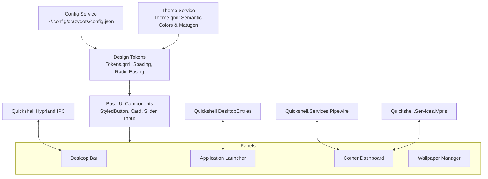

# crazydots — Engineering Specification

**Project:** crazydots  
**Ecosystem:** Vexilion  
**Compositor:** Hyprland on Arch Linux  
**Desktop Shell:** Quickshell (QML 6 & JavaScript)  
**Color Engine:** Matugen with Quickshell native fallback  
**Terminal:** Ghostty  
**License:** GPL-3.0-or-later  

---

## 1. Product Vision & Architectural Boundaries

crazydots is a cohesive, modern desktop environment interface for Hyprland built entirely on Quickshell. It provides a fluid, unified interface without stitching together disparate utilities.

### 1.1 Architectural Boundary
- **Hyprland** owns window management, workspace switching, window rules, compositor-level effects (blur, shadows, rounded corners on client windows), and global keybindings.
- **Quickshell** owns all desktop interface elements:
  - Desktop bar and system status indicators.
  - Native application launcher (eliminating reliance on external launchers like Fuzzel).
  - Wallpaper manager and dynamic theme engine.
  - Corner dashboard and quick settings.
  - Media controls and audio volume management.
  - System tray (StatusNotifierItem integration).
  - Multi-monitor variant instantiation.

Quickshell does **not** reimplement window management or workspace tiling. It integrates with Hyprland via Quickshell's native `Quickshell.Hyprland` IPC singleton and the Hyprland global shortcuts protocol.

---

## 2. Technology Stack & Dependency Policy

### 2.1 Core Technologies
- **Quickshell 0.3.2**: Desktop shell host with Wayland layer-shell protocol support.
- **Qt 6.12 / Qt Quick**: Declarative UI and scene graph rendering.
- **JavaScript (ES6+)**: Lightweight logic, state transformations, and model filtering.
- **Quickshell.Hyprland**: IPC socket interface to Hyprland compositor.
- **Quickshell.Services**: Native bindings for PipeWire (`libpipewire`), MPRIS, SystemTray, and UPower.
- **Quickshell.Io**: Asynchronous process spawning, file watching, and IPC handling.
- **Matugen**: Material You dynamic color generation from wallpapers.
- **Ghostty**: Modern GPU-accelerated terminal.

### 2.2 Dependency Tiers
1. **Tier 1 — Required Core**:
   - `quickshell-git` (>= 0.3.2)
   - `hyprland` (>= 0.56.0)
   - `qt6-declarative` (>= 6.12.0)
   - `qt6-base` (>= 6.12.0)
   - `pipewire` & `wireplumber`
2. **Tier 2 — Recommended Desktop Tools**:
   - `matugen` (for dynamic palette generation)
   - `ghostty` (primary terminal)
   - `ttf-jetbrains-mono-nerd` / `otf-caskaydiacove-nerd` (symbolic glyphs and monospace typography)
3. **Tier 3 — Optional Integrations**:
   - `brightnessctl` (hardware backlight adjustment)
   - `grim` & `slurp` (screenshot utilities)
   - `wl-clipboard` (clipboard history and copy/paste)
   - `networkmanager` (`nmcli` for network status)
4. **Tier 4 — Development & Verification**:
   - `qmllint` (static syntax checking for QML)
   - `git` (local version control and milestone tracking)
   - `python` (test runners and schema validators)

### 2.3 Graceful Degradation Strategy
- **Missing Matugen**: The theme engine detects when `matugen` is unavailable and falls back to Quickshell's built-in `ColorQuantizer` or pre-configured static palettes (Catppuccin, Tokyo Night, Nord, Gruvbox) without crashing.
- **Missing UPower**: Desktop bar battery indicators safely hide if no battery device exists (e.g., desktop workstations).
- **Missing MPRIS Player**: Media controls cleanly collapse when no active playback clients are registered.
- **Network / Bluetooth Offline**: Status widgets display a muted disconnected icon rather than failing or hanging.

---

## 3. Global Architecture & State Management

### 3.1 Design Tokens (`Tokens.qml`)
Centralizes:
- **Spacing**: `spaceXs` (4px), `spaceSm` (8px), `spaceMd` (12px), `spaceLg` (16px), `spaceXl` (24px).
- **Corner Radii**: `radiusSm` (6px), `radiusMd` (12px), `radiusLg` (18px), `radiusFull` (9999px).
- **Durations**: `durationFast` (150ms), `durationNormal` (300ms), `durationSpatial` (450ms).
- **Curves**: Deterministic Bezier splines (`expressiveSpring`, `standardDecel`, `swiftExit`).

### 3.2 Semantic Theme Schema (`Theme.qml`)
All visual components bind strictly to semantic color tokens:
- `background`: Primary desktop surface / panel backdrop.
- `surface`: Elevated cards and widget containers.
- `surfaceElevated`: Floating menus and modal overlays.
- `foreground`: Primary text and high-contrast iconography.
- `mutedForeground`: Secondary labels, timestamps, and placeholder text.
- `accent`: Primary brand/highlight color.
- `accentSecondary`: Secondary accent for active states.
- `border`: Subtle element dividers and card outlines.
- `selection`: Highlighted item backgrounds.
- `success`, `warning`, `error`: Contextual status colors.

### 3.3 Dynamic Layer-Shell Canvas & Region Masking
- Main drawer panels live on a permanent fullscreen `PanelWindow` set to `WlrLayershell.layer: WlrLayer.Overlay` with `ExclusionMode.Ignore`.
- Zero Wayland surface resizing prevents buffer reallocation stutter.
- Input click-through is achieved dynamically via `mask: Region` using `Intersection.Xor` for desktop pass-through and `Intersection.Subtract` for active panel areas.
- Motion is driven by a normalized scalar `offsetScale: open ? 0.0 : 1.0` coordinating position, opacity, and input regions simultaneously.

---

## 4. Milestone Roadmap

The project follows a strict 10-milestone sequence (M0–M9):
- **M0**: Repository Foundation & Specification
- **M1**: Design Tokens & Theme Engine
- **M2**: Configuration & Persistence Service
- **M3**: Quickshell Entry Point & Shell Base
- **M4**: Desktop Bar
- **M5**: Application Launcher
- **M6**: Wallpaper Manager & Dynamic Color Engine
- **M7**: Corner Dashboard & Quick Settings
- **M8**: Hyprland & Ghostty Integration
- **M9**: Verification, Documentation & Polish
