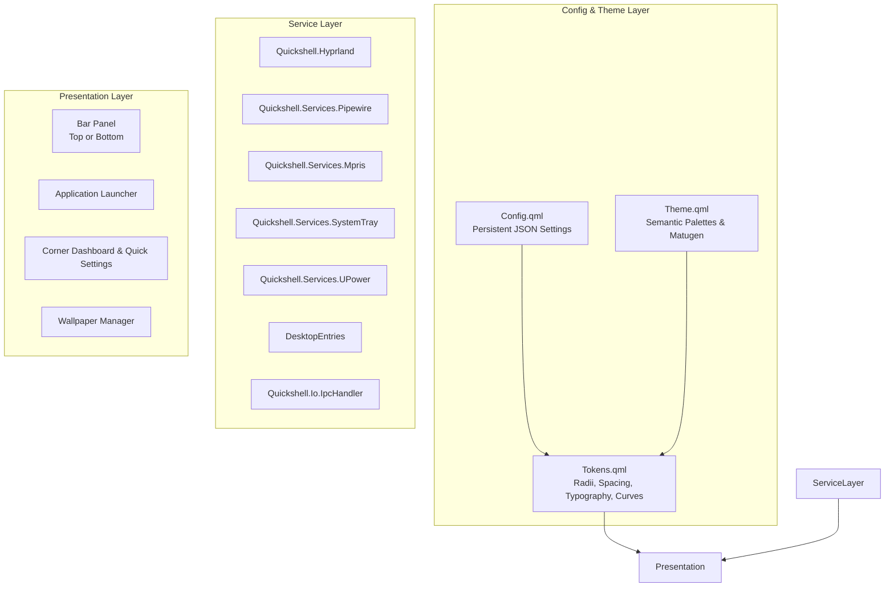

# crazydots — Architecture Documentation

This document describes the architectural design of **crazydots**, a native Quickshell desktop shell for Hyprland.

---

## 1. Core Architectural Principles

### 1.1 Pure QML 6 and JavaScript
Unlike setups that compile custom C++ shared libraries for basic utilities (e.g., config parsing, blob geometry, image luminance), crazydots is constructed entirely in standard Qt Quick / QML 6 and modern JavaScript, powered by Quickshell 0.3.2's native modules:
- `Quickshell` (Core, `ShellRoot`, `Scope`, `Variants`, `ColorQuantizer`, `DesktopEntries`)
- `Quickshell.Hyprland` (`Hyprland` singleton, `GlobalShortcut`, toplevels, workspaces)
- `Quickshell.Io` (`Process`, `FileView`, `IpcHandler`)
- `Quickshell.Services.*` (`Pipewire`, `Mpris`, `SystemTray`, `UPower`)
- `Quickshell.Wayland` (`WlrLayershell`, `Region`, `Intersection`)
- `Quickshell.Widgets` (`IconImage`, `ClippingRectangle`)

### 1.2 Zero-Resize Layer-Shell Surfaces
Wayland surface reallocations create visual stutter when animated dynamically. crazydots avoids this by using fullscreen static layer surfaces with `WlrLayershell.layer: WlrLayer.Overlay` (or `Top`) and `ExclusionMode.Ignore`:
- The window itself spans the entire monitor at all times (`anchors.fill: parent`).
- Panels slide internally across this static canvas using anchor margins driven by a scalar `offsetScale`.
- Desktop pass-through is managed through Quickshell's `mask: Region` API using boolean operations (`Intersection.Xor` and `Intersection.Subtract`).

### 1.3 State Coordination via Normalized Scalars
Rather than independently animating `y`, `opacity`, and mask dimensions, every sliding drawer exposes:
```qml
property bool open: false
property real offsetScale: open ? 0.0 : 1.0
Behavior on offsetScale {
    NumberAnimation {
        duration: open ? Tokens.anim.durationSpatial : Tokens.anim.durationEffects
        easing.type: open ? Easing.BezierSpline : Easing.BezierSpline
        easing.bezierCurve: open ? Tokens.anim.springCurve : Tokens.anim.exitCurve
    }
}
```
All visual properties (`anchors.bottomMargin`, `opacity`, input mask height) are mathematical functions of `offsetScale`. When `open` transitions, all properties animate in strict synchrony.

---

## 2. Subsystem Layout



---

## 3. Dynamic Theming Pipeline

1. **Wallpaper Selection**: Selected via the wallpaper browser or CLI script (`scripts/wallpaper-apply`).
2. **Palette Generation**:
   - Primary: Matugen generates a Material You palette in JSON format.
   - Fallback: Quickshell's native `ColorQuantizer` extracts dominant tones if Matugen is absent.
3. **Reactive Binding**: `Theme.qml` loads the active palette. Every UI element bound to semantic tokens (`Theme.background`, `Theme.surface`, `Theme.accent`) updates smoothly using `ColorAnimation` transitions.

---

## 4. Multi-Monitor Handling

Windows are instantiated dynamically using Quickshell's `Variants` component tied to `Quickshell.screens`. Each monitor receives its own scoped bar and panel instances without hardcoding display names or counts.

---

## 5. Canonical Milestone Roadmap

The implementation is structured into 10 discrete, verifiable milestones:
- **M0**: Repository Foundation & Specification
- **M1**: Design Tokens & Theme Engine
- **M2**: Configuration & Persistence Service
- **M3**: Quickshell Entry Point & Shell Base
- **M4**: Desktop Bar
- **M5**: Application Launcher
- **M6**: Wallpaper Manager & Dynamic Color Engine
- **M7**: Corner Dashboard & Quick Settings
- **M8**: Hyprland & Ghostty Integration
- **M9**: Verification, Documentation & Polish
